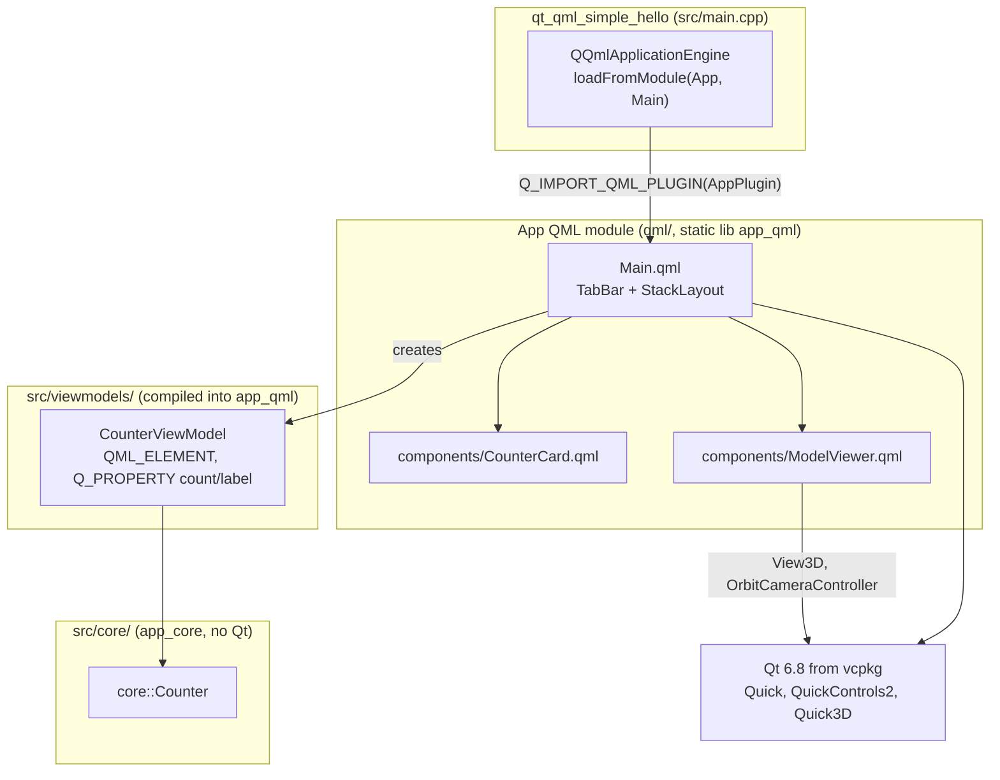
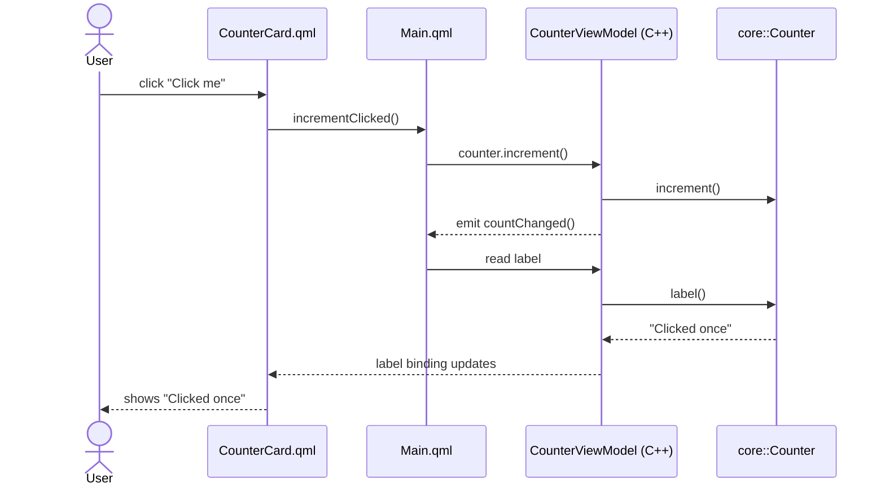
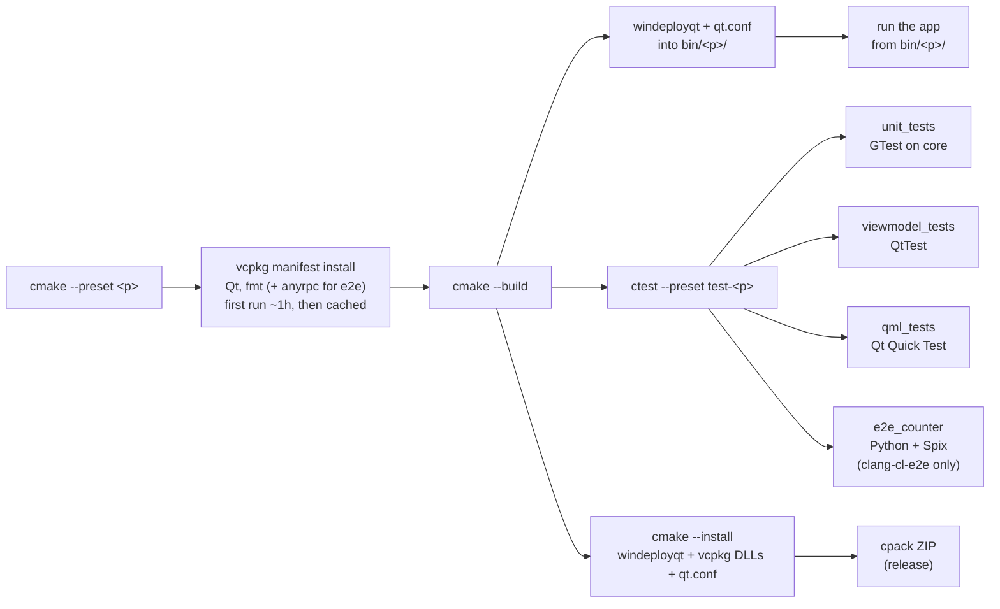

# qml-project-template

Starter for Qt 6 / QML desktop apps in C++23, built with CMake presets and vcpkg. I use it as the base for new QML tools: copy it, rename `project()`, and start adding screens.

## What it does

- **Qt-free core, QML on top** - app logic in `src/core/` (plain C++, builds and tests without Qt), `QML_ELEMENT` viewmodels in `src/viewmodels/`, UI in `qml/` as a static `App` QML module
- **Two example tabs** - a counter driven by a C++ viewmodel, and a Qt Quick 3D viewer (drag to orbit, wheel or buttons to zoom, auto-rotate)
- **Tests at every layer** - GTest for `core`, QtTest for viewmodels, Qt Quick Test for QML components, and [Spix](https://github.com/faaxm/spix) E2E where a Python script clicks through the running app
- **Runs straight from the build** - windeployqt + `qt.conf` after every build; `cmake --install` and cpack give a self-contained zip
- **Same tooling in any editor** - clangd, clang-format, clang-tidy, qmlformat and qmllint, all driven from CMake targets (see [EDITOR_SETUP.md](EDITOR_SETUP.md))

## Architecture

Dependencies only point downward: QML knows the viewmodels, the viewmodels know `core`, and `core` knows nothing about Qt (its CMake target has no Qt link and AUTOMOC is off, so an accidental `#include <QString>` fails to compile).



A click on the counter tab goes through every layer and comes back as a property binding:



## Requirements

- CMake 3.28+ and Ninja
- Windows: Visual Studio 2022 (MSVC toolset + Windows SDK) and LLVM clang-cl. Configure from a *Developer PowerShell for VS 2022*
- vcpkg (`C:/vcpkg`, `VCPKG_ROOT`, or PATH). Qt 6.8.3 comes from it; the first configure builds Qt from source (~1h), later ones restore it from vcpkg's binary cache
- Python 3 for the E2E test
- Tested on: Windows 11 with clang-cl (`clang-cl-debug`, `clang-cl-release`, `clang-cl-e2e`)

`scripts/setup-windows.ps1` (or `scripts/setup-ubuntu.sh`) installs the toolchain.

## Quick start

```bash
git clone https://github.com/royyandzakiy/qml-project-template.git
cd qml-project-template
cmake --preset clang-cl-debug -D BUILD_TESTING=ON
cmake --build --preset clang-cl-debug
ctest --preset test-clang-cl-debug
```

The app ends up in `bin/clang-cl-debug/qt_qml_simple_hello.exe`. Other presets worth knowing:

| Preset | What it's for |
|--------|---------------|
| `clang-cl-release` | Release build; `cpack --config build/clang-cl-release/CPackConfig.cmake` zips it |
| `clang-cl-e2e` | Debug + Spix server, also runs the Python E2E (test builds only, it opens an automation port) |
| `msvc-*`, `clang-linux-*`, `gcc-linux-*`, `appleclang-*` | Other toolchains (`cmake --list-presets`) |

Build options (ccache, PCH, sanitizers, clang-tidy, Tracy, ...) live in `project_options.cmake`.

## Build, test, ship



CI (`.github/workflows/build-and-test.yml`) runs the same presets on Windows: `clang-cl-debug`, `clang-cl-release` (plus the zip) and `clang-cl-e2e`.

## Starting a new project from it

1. Rename `project()` in `CMakeLists.txt`, swap `resources/app.ico`, set `version.txt`.
2. New `.qml` files go into `QML_FILES` in `qml/CMakeLists.txt`; C++ types that QML uses go into `SOURCES` there.
3. Logic that doesn't need Qt goes into `src/core/`, with GTest tests next to the others in `test/`.

## Limitations

- Only Windows clang-cl is verified. The Linux/macOS presets and `setup-ubuntu.sh` exist but haven't been run yet.
- MinGW isn't supported (vcpkg's Qt on MinGW triplets is too fragile).
- Every extra Qt module (e.g. `qtserialport`) means another long vcpkg build, once.
- Extracting the release zip into a very deep folder breaks QML plugin loading (Windows' 260-character path limit).

More notes in [DEVELOPMENT.md](DEVELOPMENT.md) and [CHANGELOG.md](CHANGELOG.md). Built on top of my [cpp-project-template](https://github.com/royyandzakiy/cpp-project-template).

## License

MIT - see [LICENSE](LICENSE).
